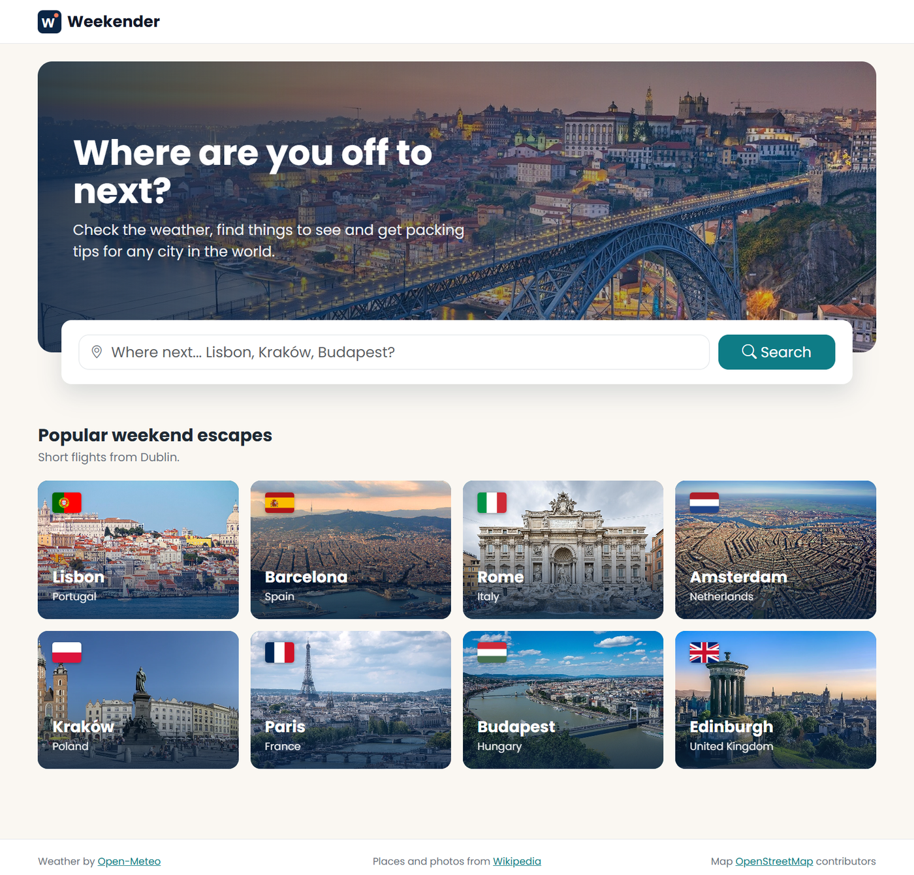
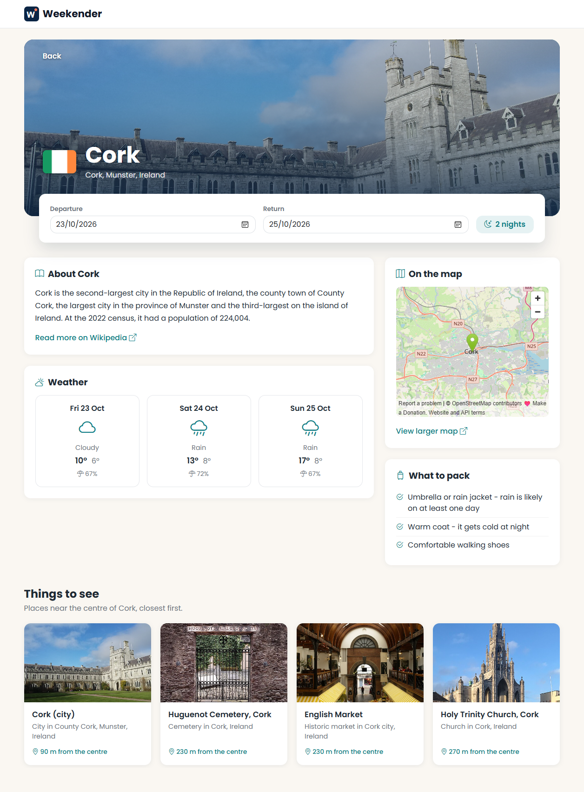

# Weekender

Weekender is a Blazor web app in C# (.NET 10) that helps you plan a weekend away. You search for a city, pick your dates and the app shows you the weather for those days, what to pack, a short description of the city, a map and places to visit nearby.

I made it for the Service Oriented Architecture (SD4) CA1 at DkIT. It uses two third party web services, Open-Meteo and Wikipedia.




## What the app does

On the home page you can search for any city in the world. If there are a few places with the same name, like Paris in France and Paris in Texas, the results show the flag, region and country so you can pick the right one. Under the search there are eight popular cities with short flights from Dublin.

When you choose a city you go to its plan page. The trip is set to next Friday to Sunday and you can change the dates. The page shows the forecast for each day, packing tips based on that forecast, a summary of the city from Wikipedia, a map and the places to see near the centre, closest first. If one of the services fails, the rest of the page still works and the user sees a simple message instead of an error.

## Web services

| Service | What I use it for |
|---|---|
| Open-Meteo Geocoding API | Finding the cities when the user searches |
| Open-Meteo Forecast API | Daily weather, max and min temperature and chance of rain, up to 16 days ahead |
| Wikipedia REST API (page summary) | Description, photo and link of the city |
| Wikipedia Action API (geosearch) | Places within 10 km of the city with their photo and coordinates |
| Wikipedia Action API (pageimages) | Photos of the eight popular cities in one request |

The map is an OpenStreetMap embed and the flags come from flagcdn. Those are only links, they are not called from C#.

## How it's built

Each web service has its own service class with an interface (IGeocodingService, IWeatherService and IWikipediaService). They are registered in Program.cs with dependency injection and the pages get them with @inject. The services use RestSharp to call the APIs and Newtonsoft.Json to read the responses.

The JSON is read into the classes in ApiModels and then turned into my own classes in Models (Destination, DailyForecast, PlaceSummary and Landmark), following the Translator pattern from the SD4 notes. If a call fails, the service throws my own ApiException and the page catches it and shows a friendly message.

Some of the C# parts from the brief: Landmark implements IComparable so the places can be sorted by distance with Sort(), and Landmark and Destination override Equals and GetHashCode. WeatherCondition is an enum, the services use lists and a dictionary for the city photos, and PackingAdvisor uses LINQ. On the plan page the weather, the summary and the places are loaded at the same time with Task.WhenAll.

## How to run it

You need the .NET 10 SDK and an internet connection. There is no database and nothing to configure.

```
git clone https://github.com/hypzx2105/Weekender.git
cd Weekender
dotnet run --project Weekender
```

You can also open Weekender.slnx in Rider and press Run.

## Tests

The tests are in Weekender.Tests and use xUnit. You can run them with `dotnet test`. There are 30 tests and they all pass.

The services keep the JSON parsing in static Parse methods, so I can test them with sample JSON based on real responses without calling the internet. The tests cover the models (equality, sorting and URLs), the helpers (dates, packing tips and distances) and the parsing of the three services, including wrong JSON, a Wikipedia article about a different city with the same name and places without photos. I used [Theory] with [InlineData] to check boundary values, like 49% and 50% chance of rain or the last day of the forecast.

I also tested the app by hand: searching a city, a name that doesn't exist and a single letter, opening a popular city, putting the return date before the departure, choosing dates more than 16 days away, opening /plan with no city, choosing Paris in Texas and searching with the internet turned off. They all worked as expected.

## Background

The idea comes from two of my earlier projects, a PHP site about places to visit in Panama and a full stack app about Dublin attractions. Weekender keeps the same idea but works with live web services.

## References

Every link here is also in a comment in the file where I used it.

| Reference | Used in |
|---|---|
| [Open-Meteo Geocoding API](https://open-meteo.com/en/docs/geocoding-api) | GeocodingService.cs, GeocodingResponse.cs, GeocodingServiceTests.cs |
| [Open-Meteo Forecast API and weather codes](https://open-meteo.com/en/docs) | WeatherService.cs, ForecastResponse.cs, DailyForecast.cs, WeatherServiceTests.cs |
| [Wikipedia REST API](https://en.wikipedia.org/api/rest_v1/) | WikipediaService.cs, WikipediaResponses.cs, WikipediaServiceTests.cs |
| [MediaWiki Geosearch](https://www.mediawiki.org/wiki/API:Geosearch) | WikipediaService.cs, WikipediaResponses.cs, WikipediaServiceTests.cs |
| [MediaWiki Nearby places viewer](https://www.mediawiki.org/wiki/API:Nearby_places_viewer) | WikipediaServiceTests.cs |
| [MediaWiki PageImages](https://www.mediawiki.org/wiki/Extension:PageImages) | WikipediaService.cs, WikipediaServiceTests.cs |
| [MediaWiki JSON version 2](https://www.mediawiki.org/wiki/API:JSON_version_2) | WikipediaService.cs, WikipediaServiceTests.cs |
| [Wikimedia User-Agent policy](https://foundation.wikimedia.org/wiki/Policy:User-Agent_policy) | WikipediaService.cs |
| [Haversine formula](https://en.wikipedia.org/wiki/Haversine_formula) | GeoHelper.cs |
| [OpenStreetMap embed](https://wiki.openstreetmap.org/wiki/Export) | Destination.cs |
| [OpenStreetMap copyright](https://www.openstreetmap.org/copyright) | MainLayout.razor |
| [Flagpedia flagcdn](https://flagpedia.net/download/api) | Destination.cs |
| [RestSharp](https://restsharp.dev) | GeocodingService.cs, WeatherService.cs |
| [Newtonsoft.Json JsonProperty](https://www.newtonsoft.com/json/help/html/JsonPropertyName.htm) | GeocodingResponse.cs, ForecastResponse.cs, WikipediaResponses.cs |
| [IComparable](https://learn.microsoft.com/en-us/dotnet/api/system.icomparable-1) | Landmark.cs |
| [GetHashCode](https://learn.microsoft.com/en-us/dotnet/api/system.object.gethashcode) | Landmark.cs, Destination.cs |
| [CultureInfo.InvariantCulture](https://learn.microsoft.com/en-us/dotnet/api/system.globalization.cultureinfo.invariantculture) | Destination.cs |
| [Uri.EscapeDataString](https://learn.microsoft.com/en-us/dotnet/api/system.uri.escapedatastring) | Destination.cs |
| [Custom exceptions](https://learn.microsoft.com/en-us/dotnet/standard/exceptions/how-to-create-user-defined-exceptions) | ApiException.cs |
| [Blazor dependency injection](https://learn.microsoft.com/en-us/aspnet/core/blazor/fundamentals/dependency-injection) | Program.cs |
| [ASP.NET Core localization](https://learn.microsoft.com/en-us/aspnet/core/fundamentals/localization) | Program.cs |
| [Blazor navigation and query strings](https://learn.microsoft.com/en-us/aspnet/core/blazor/fundamentals/navigation) | Plan.razor, DestinationSearch.razor |
| [Blazor data binding](https://learn.microsoft.com/en-us/aspnet/core/blazor/components/data-binding) | Plan.razor |
| [Task.WhenAll](https://learn.microsoft.com/en-us/dotnet/api/system.threading.tasks.task.whenall) | Plan.razor |
| [Blazor CSS isolation](https://learn.microsoft.com/en-us/aspnet/core/blazor/components/css-isolation) | Plan.razor.css |
| [MDN object-fit](https://developer.mozilla.org/en-US/docs/Web/CSS/object-fit) | Plan.razor.css, LandmarkCard.razor.css, PopularCities.razor.css |
| [MDN CSS grid](https://developer.mozilla.org/en-US/docs/Web/CSS/CSS_grid_layout) | Plan.razor.css, MainLayout.razor.css, DestinationSearch.razor.css, PopularCities.razor.css |
| [MDN media queries](https://developer.mozilla.org/en-US/docs/Web/CSS/CSS_media_queries/Using_media_queries) | Plan.razor.css |
| [MDN linear-gradient](https://developer.mozilla.org/en-US/docs/Web/CSS/gradient/linear-gradient) | Home.razor.css |
| [MDN ::after](https://developer.mozilla.org/en-US/docs/Web/CSS/::after) | PopularCities.razor.css |
| [MDN position sticky](https://developer.mozilla.org/en-US/docs/Web/CSS/position) | NavMenu.razor.css |
| [MDN CSS custom properties](https://developer.mozilla.org/en-US/docs/Web/CSS/Using_CSS_custom_properties) | app.css |
| [Bootstrap Icons](https://icons.getbootstrap.com) | App.razor, DailyForecast.cs |
| [Google Fonts Poppins](https://fonts.google.com/specimen/Poppins) | App.razor |
| [xUnit](https://xunit.net) | Weekender.Tests |
| SD4 lecture notes and labs (Ruth McKeever) | General structure, Translator pattern and code style |

## Credits

Weather data from Open-Meteo (CC BY 4.0). City summaries and photos from Wikipedia and Wikimedia Commons, each photo belongs to its author. Map by OpenStreetMap contributors. Flags from flagcdn.com, icons from Bootstrap Icons and the Poppins font from Google Fonts. The photo of Porto on the home page is from [WallpaperCat](https://wallpapercat.com/portugal-wallpapers).

Iker Arza, DkIT, BSc in Computing in Software Development, 2026/27
